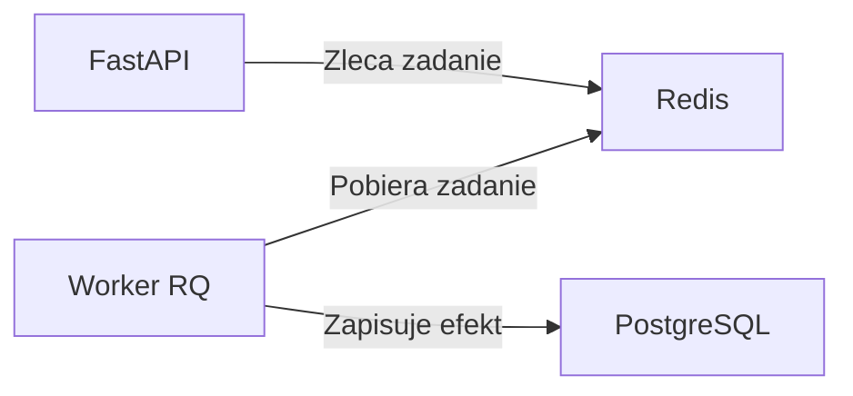

# LAB 06 — Redis, kolejka i worker

Po zgłoszeniu incydentu operator chce zlecić powiadomienie i od razu dostać identyfikator zadania. Osobny worker pobierze zadanie z kolejki i zapisze w PostgreSQL ślad powiadomienia. W tym ćwiczeniu zapis w tabeli symuluje wysyłkę.

**Punkt startowy** to lokalne laboratorium IncidentFlow z katalogiem `api/` i plikiem `compose.yaml`. W jego repozytorium utwórz gałąź `lab/06-redis-worker`. Ustaw `BASE_URL` na `http://localhost:8080`, jeśli po LAB 03 korzystasz z Nginx. Domyślny adres MVP to `http://localhost:8000`.



## 1. Uruchom Redis i worker

1. Dodaj usługę `redis` z obrazu Redis 7, z kontrolą stanu `redis-cli ping`. Komunikacja odbywa się w sieci Compose pod `redis:6379`, bez mapowania portu na hosta.
2. Dodaj biblioteki `redis` i `rq` do zależności API. Przekaż `REDIS_URL=redis://redis:6379/0` do usług `api` i `worker`.
3. Dodaj usługę `worker` z tym samym kontekstem budowy `./api`. W poleceniu startowym uruchom `rq worker --url redis://redis:6379/0 --with-scheduler notifications`. Worker potrzebuje też tego samego `DATABASE_URL` co API. Użyj `depends_on` z `service_healthy` dla Redis w konfiguracji workera.
4. W `api/app/jobs.py` przygotuj importowalną funkcję `notify_incident(incident_id)`. Zacznij od logowania ID incydentu i zadania. Zleć ją testowo z kontenera API do kolejki `notifications` i znajdź jej wykonanie w logach workera.

```bash
docker compose config --quiet
docker compose up -d --build
docker compose ps
docker compose exec redis redis-cli ping
docker compose logs --tail=50 worker
```

## 2. Zleć zadanie przez API i zapisz efekt

- Dodaj `POST /incidents/{incident_id}/notification`. Zwróć `404` dla nieznanego incydentu. Dla istniejącego zleć `notify_incident` i po zapisie zadania w kolejce zwróć `202 Accepted` oraz JSON z `job_id`. Kod 202 potwierdza przyjęcie zadania do kolejki.
- Dodaj model tabeli `notification_events` z polami `incident_id`, `event_type` i `created_at`. Użyj istniejącego silnika bazy i zaimportuj model przed wywołaniem `Base.metadata.create_all` w API.
- Nałóż ograniczenie unikalności na parę `(incident_id, event_type)`. W workerze zapisz zdarzenie w transakcji przez `INSERT … ON CONFLICT (incident_id, event_type) DO NOTHING` lub odpowiednik SQLAlchemy dla PostgreSQL. Zleć powiadomienie dwa razy dla tego samego incydentu. W logach powinny być dwa zadania, a w bazie jeden wiersz.
- Ustaw ograniczony czas połączenia i odczytu Redis w kliencie API. Przy błędzie połączenia lub przekroczeniu limitu czasu zwróć z endpointu powiadomień `503`. Pozostaw `/ready` jako sprawdzanie połączenia z PostgreSQL.

Utwórz incydent przez `/docs` i użyj jego ID w poleceniu:

```bash
BASE_URL=${BASE_URL:-http://localhost:8000}
INCIDENT_ID=1  # podmień na ID utworzonego incydentu
curl -i -X POST "$BASE_URL/incidents/$INCIDENT_ID/notification"
docker compose logs --tail=50 worker
```

## 3. Przećwicz awarie

| Scenariusz | Kroki | Oczekiwany wynik |
| --- | --- | --- |
| Zatrzymany worker | `docker compose stop worker`, zleć powiadomienie, potem `docker compose start worker` | API zwraca 202, zadanie czeka w kolejce i wykonuje się po starcie workera. |
| Chwilowy błąd zadania | Dodaj `Retry(max=2, interval=[5, 10])` przy zlecaniu. W lokalnym teście zgłoś wyjątek tylko podczas pierwszej próby danego zadania. | W logach widać błąd i ponowną próbę, a w bazie jest jeden wiersz dla zdarzenia. |
| Niedostępny Redis | `docker compose stop redis`, zleć powiadomienie i sprawdź `/ready`. Przywróć usługi przez `docker compose up -d redis worker`. | Endpoint powiadomień zwraca 503. `/ready` zwraca 200, gdy PostgreSQL działa. Po naprawie nowa próba zlecenia zwraca 202. |

Do testu chwilowego błędu możesz użyć tymczasowej flagi Redis z kluczem zawierającym `job_id`. `SET` z opcjami `NX` i `EX 300` ustawi flagę tylko przy pierwszej próbie tego zadania. Zgłoś wyjątek po ustawieniu flagi i usuń ten fragment po ćwiczeniu.

## Kryteria zaliczenia

- `redis-cli ping` zwraca `PONG`, a worker nasłuchuje na kolejce `notifications`.
- Endpoint zwraca `202` z `job_id`, a ślad powiadomienia można odczytać w PostgreSQL.
- Dwa zlecenia dla tego samego incydentu kończą się jednym wierszem w `notification_events`.
- Potrafisz pokazać w logach, co dzieje się po zatrzymaniu workera oraz podczas ponownej próby.
- Zapisz w `docs/POSTMORTEM-06.md` objaw, przyczynę, diagnozę, naprawę i dowód powrotu do działania. Commit do laboratorium: `feat(worker): queue incident notifications with Redis`.

**Bonus** Zleć zadanie, które zawsze kończy się błędem. Po wyczerpaniu ponowień znajdź je w rejestrze zadań zakończonych błędem RQ i zapisz, jakie informacje pozwoliłyby Ci zdecydować o ponownym uruchomieniu.

## Dokumentacja

- [RQ — wyjątki i ponawianie zadań](https://python-rq.org/docs/exceptions/)
- [Docker Compose — kolejność uruchamiania usług](https://docs.docker.com/compose/how-tos/startup-order/)

**Gotowe przykłady do skopiowania**

Poniższa ścieżka realizuje ćwiczenie na kodzie startowym IncidentFlow. Przykłady są w [examples/lab-06](../examples/lab-06).

| Plik | Do czego służy |
| --- | --- |
| [compose.lab06.yaml](../examples/lab-06/compose.lab06.yaml) | Dopisuje Redis i workera oraz adres kolejki dla API. |
| [requirements-lab06.txt](../examples/lab-06/requirements-lab06.txt) | Dodaje biblioteki Redis i RQ. |
| [notification_models.py](../examples/lab-06/notification_models.py) | Definiuje tabelę ze śladem powiadomienia. |
| [jobs.py](../examples/lab-06/jobs.py) | Zapisuje jeden wiersz dla danej pary incydentu i typu zdarzenia. |
| [notifications.py](../examples/lab-06/notifications.py) | Dodaje endpoint zlecający zadanie do kolejki. |
| [retry_demo.py](../examples/lab-06/retry_demo.py) | Powoduje kontrolowany błąd pierwszej próby konkretnego zadania. |

**Przykład 1. Przygotuj pliki**

W lokalnym klonie `DevOpsProjectAI` pobierz zmiany przez `git pull --ff-only` i wpisz `pwd`. Zanotuj pełną ścieżkę. Jeżeli korzystasz dopiero z przeglądarki, najpierw sklonuj repozytorium:

```bash
git clone https://github.com/Dawid26/DevOpsProjectAI.git
cd DevOpsProjectAI
pwd
```

Przejdź do osobnego katalogu aplikacji IncidentFlow, gdzie są `compose.yaml` i `api/app/main.py`. Wpisz `git status` i zapisz swoje wcześniejsze zmiany. Ustaw `LAB_SOURCE` na zanotowaną ścieżkę, podmieniając przykładowy login:

```bash
export LAB_SOURCE=/home/twoj-login/DevOpsProjectAI
ls "$LAB_SOURCE/examples/lab-06"
cp -i "$LAB_SOURCE/examples/lab-06/"*.py api/app/
cp -i "$LAB_SOURCE/examples/lab-06/requirements-lab06.txt" api/
cp -i "$LAB_SOURCE/examples/lab-06/compose.lab06.yaml" .
```

Opcja `-i` pyta przed nadpisaniem istniejącego pliku. Jeśli masz już własny `jobs.py` lub inne rozwiązanie LAB 06, połącz odpowiednie fragmenty ze swoim kodem.

Na końcu `api/requirements.txt` dopisz jedną linię:

```text
-r requirements-lab06.txt
```

Dockerfile kopiuje obecnie tylko główny plik zależności. W `api/Dockerfile` zmień linię `COPY requirements.txt ./` na:

```dockerfile
COPY requirements.txt requirements-lab06.txt ./
```

W `api/app/main.py`, obok pozostałych importów, dopisz:

```python
from .notifications import router as notifications_router
```

Bezpośrednio pod istniejącą linią `app = FastAPI(...)` dopisz:

```python
app.include_router(notifications_router)
```

Import wczyta także model nowej tabeli, zanim istniejące `Base.metadata.create_all` wykona się podczas startu API. Router dopisze nową ścieżkę do aplikacji.

Jeśli wcześniej utworzyłeś już tabelę `notification_events`, porównaj jej kolumny i ograniczenie unikalności z modelem. `create_all` tworzy brakujące tabele, a aktualizacja istniejącej tabeli wymaga migracji. Zachowaj dotychczasowe dane.

**Przykład 2. Uruchom cztery usługi**

W tej karcie terminala ustaw:

```bash
export COMPOSE_FILE=compose.yaml:compose.lab06.yaml
docker compose config --quiet
docker compose up -d --build
docker compose ps
docker compose exec redis redis-cli ping
```

`COMPOSE_FILE` każe Compose połączyć bazowy plik z dodatkami LAB 06. Przy otwieraniu kolejnej karty terminala ustaw tę zmienną ponownie. W `docker compose ps` znajdziesz usługi `api`, `db`, `redis` i `worker`, a komenda ping zwróci `PONG`.

```bash
export BASE_URL=http://localhost:8000
curl -i "$BASE_URL/ready"
docker compose logs --tail=30 worker
```

Dostosuj `BASE_URL` do portu 8080, jeśli korzystasz z Nginx. Poczekaj na HTTP 200 z `/ready` oraz komunikat workera o nasłuchiwaniu na `notifications`.

**Przykład 3. Utwórz incydent i zleć powiadomienie**

```bash
export INCIDENT_ID=$(
  curl -fsS -X POST "$BASE_URL/incidents" \
    -H 'Content-Type: application/json' \
    -d '{"title":"Test kolejki LAB 06","severity":"high"}' |
  python3 -c 'import json, sys; print(json.load(sys.stdin)["id"])'
)
echo "$INCIDENT_ID"
curl -i -X POST "$BASE_URL/incidents/$INCIDENT_ID/notification"
docker compose logs --tail=30 worker
```

Pierwsze polecenie tworzy prawdziwy incydent. Python odczytuje jego numer z odpowiedzi API i zapisuje go w `INCIDENT_ID`. Kolejne żądanie zwróci HTTP 202 i odpowiedź w tym kształcie:

```json
{"job_id":"identyfikator-wygenerowany-przez-rq","incident_id":1}
```

Numer incydentu i `job_id` będą zależeć od Twojego uruchomienia. Po wykonaniu zadania w logach workera pojawi się np. `incident_id=1 notification=created`.

Sprawdź zapis w PostgreSQL:

```bash
docker compose exec db sh -c 'psql -U "$POSTGRES_USER" -d "$POSTGRES_DB" -c "SELECT incident_id, event_type FROM notification_events ORDER BY id;"'
```

**Przykład 4. Wyślij drugi raz i sprawdź ochronę przed duplikatem**

```bash
curl -i -X POST "$BASE_URL/incidents/$INCIDENT_ID/notification"
docker compose logs --tail=30 worker
docker compose exec db sh -c 'psql -U "$POSTGRES_USER" -d "$POSTGRES_DB" -c "SELECT incident_id, event_type, COUNT(*) FROM notification_events GROUP BY incident_id, event_type;"'
```

Drugie zlecenie ma własny `job_id`. Worker wypisze `notification=already_exists`, a licznik dla tej pary incydentu i typu powiadomienia wyniesie 1. Poczekaj na zakończenie zadania, jeśli wynik SQL odczytujesz od razu.

Dla nieistniejącego incydentu, np. numeru 999999, który wcześniej sprawdzisz przez `GET /incidents/999999`, endpoint powiadomień zwróci 404:

```bash
curl -i -X POST "$BASE_URL/incidents/999999/notification"
```

**Przykład 5. Zatrzymaj workera i obejrzyj czekające zadanie**

```bash
docker compose stop worker
curl -i -X POST "$BASE_URL/incidents/$INCIDENT_ID/notification"
docker compose exec api rq info --url redis://redis:6379/0
docker compose start worker
docker compose logs --tail=30 worker
```

Po zleceniu dostaniesz 202, a `rq info` pokaże zadanie czekające na kolejce. Po uruchomieniu workera zadanie zostanie przetworzone. Dla incydentu z wcześniejszych przykładów wynikiem będzie `already_exists`.

**Przykład 6. Zobacz błąd pierwszej próby i ponowienie**

Wklej cały blok do terminala WSL. `-T` pozwala przekazać poniższy skrypt do Pythona wewnątrz kontenera:

```bash
docker compose exec -T -e INCIDENT_ID="$INCIDENT_ID" api python - <<'PY'
import os

from redis import Redis
from rq import Queue, Retry

from app.retry_demo import fail_once_then_notify

connection = Redis.from_url(os.environ["REDIS_URL"])
queue = Queue("notifications", connection=connection)
job = queue.enqueue(
    fail_once_then_notify,
    int(os.environ["INCIDENT_ID"]),
    retry=Retry(max=2, interval=[5, 10]),
)
print("Obserwuj zadanie:", job.id)
PY

docker compose logs -f worker
```

W logach zobaczysz `LAB 06 controlled first-attempt failure`. Kolejna próba wykona zapis lub rozpozna istniejący wiersz. Zadanie jest planowane do ponowienia po 5 sekundach; odczyt przez scheduler może zająć dodatkową chwilę. `Ctrl+C` kończy obserwację logów.

Funkcja demonstracyjna zapisuje w Redis flagę przypisaną do `job_id`. Pierwsza próba ustawia flagę i zgłasza błąd, a kolejna przechodzi dalej. Zwykły endpoint korzysta z funkcji `notify_incident`.

**Przykład 7. Wyłącz Redis i sprawdź 503**

```bash
docker compose stop redis
curl -i -X POST "$BASE_URL/incidents/$INCIDENT_ID/notification"
curl -i "$BASE_URL/ready"
docker compose up -d redis
docker compose restart worker
curl -i -X POST "$BASE_URL/incidents/$INCIDENT_ID/notification"
```

Przy wyłączonym Redis endpoint powiadomień zwróci HTTP 503 z tekstem `Notification queue unavailable`. Gdy PostgreSQL działa, `/ready` nadal zwróci 200. Po przywróceniu Redis poczekaj na `PONG`, ponów ostatnie żądanie i sprawdź 202.

Zapisz wyniki w `docs/POSTMORTEM-06.md`. Przy przechodzeniu do LAB 07 dodawaj `-f compose.lab06.yaml` pomiędzy `-f compose.yaml` i `-f compose.image.yaml`, aby zachować Redis i konfigurację workera z tych przykładów.

Szczegóły mechanizmu zapisu opisuje [SQLAlchemy — PostgreSQL ON CONFLICT](https://docs.sqlalchemy.org/en/20/dialects/postgresql.html#insert-on-conflict-upsert), a łączenie plików opisuje [Docker Compose — merge](https://docs.docker.com/compose/how-tos/multiple-compose-files/merge/).
