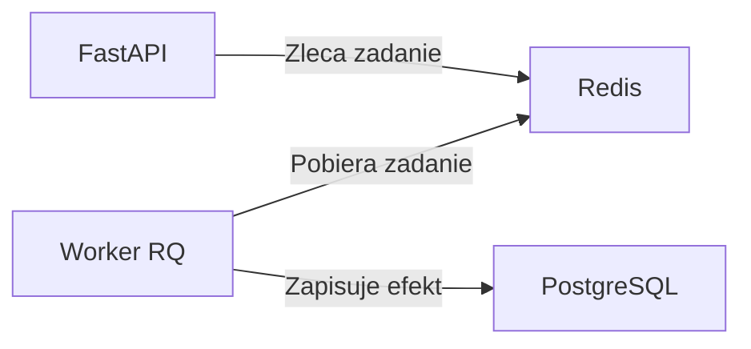

# LAB 06 — Redis, kolejka i worker

Po zgłoszeniu incydentu operator chce zlecić powiadomienie i od razu dostać identyfikator zadania. Osobny worker pobierze zadanie z kolejki i zapisze w PostgreSQL ślad powiadomienia. W tym ćwiczeniu zapis w tabeli symuluje wysyłkę.

**Punkt startowy** to lokalne laboratorium IncidentFlow z katalogiem `api/` i plikiem `compose.yaml`. W jego repozytorium utwórz gałąź `lab/06-redis-worker`. Ustaw `BASE_URL` na `http://localhost:8080`, jeśli po LAB 03 korzystasz z Nginx. Domyślny adres MVP to `http://localhost:8000`.



## 1. Uruchom Redis i worker

1. Dodaj usługę `redis` z obrazu Redis 7, z kontrolą stanu `redis-cli ping`. Komunikacja odbywa się w sieci Compose pod `redis:6379`, bez mapowania portu na hosta.
2. Dodaj biblioteki `redis` i `rq` do zależności API. Przekaż `REDIS_URL=redis://redis:6379/0` do usług `api` i `worker`.
3. Dodaj usługę `worker` z tym samym kontekstem budowy `./api`. W poleceniu startowym uruchom `rq worker --url redis://redis:6379/0 --with-scheduler notifications`. Worker potrzebuje też tego samego `DATABASE_URL` co API. Użyj `depends_on` z `service_healthy` dla Redis w konfiguracji workera.
4. W `api/app/jobs.py` przygotuj importowalną funkcję `notify_incident(incident_id)`. Zacznij od logowania ID incydentu i zadania. Zleć ją testowo z kontenera API do kolejki `notifications` i znajdź jej wykonanie w logach workera.

```bash
docker compose config --quiet
docker compose up -d --build
docker compose ps
docker compose exec redis redis-cli ping
docker compose logs --tail=50 worker
```

## 2. Zleć zadanie przez API i zapisz efekt

- Dodaj `POST /incidents/{incident_id}/notification`. Zwróć `404` dla nieznanego incydentu. Dla istniejącego zleć `notify_incident` i po zapisie zadania w kolejce zwróć `202 Accepted` oraz JSON z `job_id`. Kod 202 potwierdza przyjęcie zadania do kolejki.
- Dodaj model tabeli `notification_events` z polami `incident_id`, `event_type` i `created_at`. Użyj istniejącego silnika bazy i zaimportuj model przed wywołaniem `Base.metadata.create_all` w API.
- Nałóż ograniczenie unikalności na parę `(incident_id, event_type)`. W workerze zapisz zdarzenie w transakcji przez `INSERT … ON CONFLICT (incident_id, event_type) DO NOTHING` lub odpowiednik SQLAlchemy dla PostgreSQL. Zleć powiadomienie dwa razy dla tego samego incydentu. W logach powinny być dwa zadania, a w bazie jeden wiersz.
- Ustaw ograniczony czas połączenia i odczytu Redis w kliencie API. Przy błędzie połączenia lub przekroczeniu limitu czasu zwróć z endpointu powiadomień `503`. Pozostaw `/ready` jako sprawdzanie połączenia z PostgreSQL.

Utwórz incydent przez `/docs` i użyj jego ID w poleceniu:

```bash
BASE_URL=${BASE_URL:-http://localhost:8000}
INCIDENT_ID=1  # podmień na ID utworzonego incydentu
curl -i -X POST "$BASE_URL/incidents/$INCIDENT_ID/notification"
docker compose logs --tail=50 worker
```

## 3. Przećwicz awarie

| Scenariusz | Kroki | Oczekiwany wynik |
| --- | --- | --- |
| Zatrzymany worker | `docker compose stop worker`, zleć powiadomienie, potem `docker compose start worker` | API zwraca 202, zadanie czeka w kolejce i wykonuje się po starcie workera. |
| Chwilowy błąd zadania | Dodaj `Retry(max=2, interval=[5, 10])` przy zlecaniu. W lokalnym teście zgłoś wyjątek tylko podczas pierwszej próby danego zadania. | W logach widać błąd i ponowną próbę, a w bazie jest jeden wiersz dla zdarzenia. |
| Niedostępny Redis | `docker compose stop redis`, zleć powiadomienie i sprawdź `/ready`. Przywróć usługi przez `docker compose up -d redis worker`. | Endpoint powiadomień zwraca 503. `/ready` zwraca 200, gdy PostgreSQL działa. Po naprawie nowa próba zlecenia zwraca 202. |

Do testu chwilowego błędu możesz użyć tymczasowej flagi Redis z kluczem zawierającym `job_id`. `SET` z opcjami `NX` i `EX 300` ustawi flagę tylko przy pierwszej próbie tego zadania. Zgłoś wyjątek po ustawieniu flagi i usuń ten fragment po ćwiczeniu.

## Kryteria zaliczenia

- `redis-cli ping` zwraca `PONG`, a worker nasłuchuje na kolejce `notifications`.
- Endpoint zwraca `202` z `job_id`, a ślad powiadomienia można odczytać w PostgreSQL.
- Dwa zlecenia dla tego samego incydentu kończą się jednym wierszem w `notification_events`.
- Potrafisz pokazać w logach, co dzieje się po zatrzymaniu workera oraz podczas ponownej próby.
- Zapisz w `docs/POSTMORTEM-06.md` objaw, przyczynę, diagnozę, naprawę i dowód powrotu do działania. Commit do laboratorium: `feat(worker): queue incident notifications with Redis`.

**Bonus** Zleć zadanie, które zawsze kończy się błędem. Po wyczerpaniu ponowień znajdź je w rejestrze zadań zakończonych błędem RQ i zapisz, jakie informacje pozwoliłyby Ci zdecydować o ponownym uruchomieniu.

## Dokumentacja

- [RQ — wyjątki i ponawianie zadań](https://python-rq.org/docs/exceptions/)
- [Docker Compose — kolejność uruchamiania usług](https://docs.docker.com/compose/how-tos/startup-order/)
